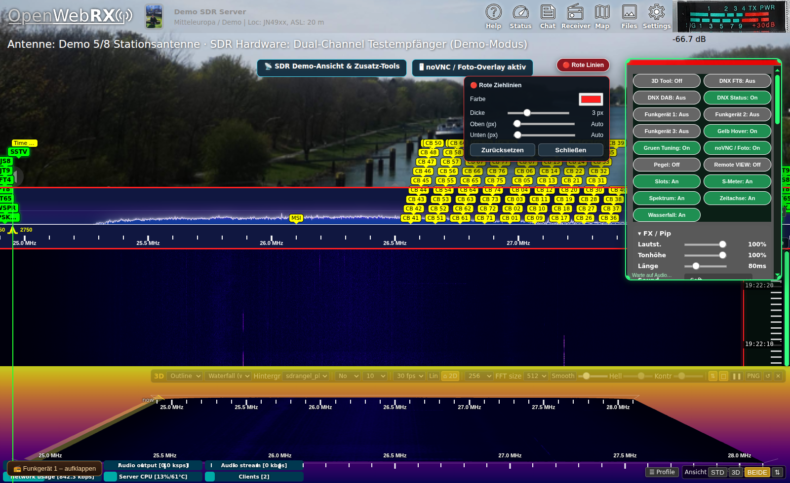
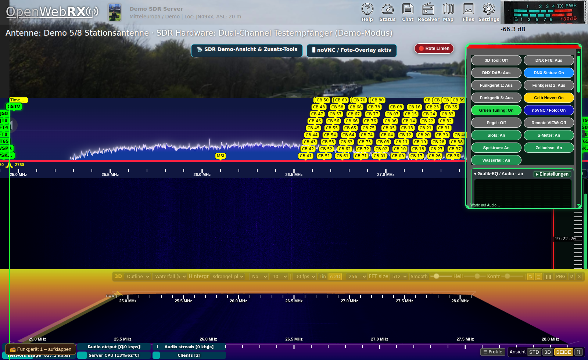

# DNX Red Resize Lines (`v1.0.0`)

<!-- DNX-DISCLAIMER-START -->
> **Wichtiger Hinweis / Vollständige Distanzierung (Hobby-Mod-Mode)**
>
> - **Vollständige Distanzierung:** Ich distanziere mich in jeder Hinsicht vollständig vom Projekt **OpenWebRX / OpenWebRX+** sowie dessen Entwicklern und Betreibern. Es besteht keinerlei Verbindung, Zusammenarbeit, Prüfung, Befürwortung oder Partnerschaft.
> - **Keine öffentlichen/offiziellen OpenWebRX-Plugins (nur Mod-Mode):** Bei diesem Projekt handelt es sich ausdrücklich **nicht** um ein öffentliches oder offizielles Plugin von OpenWebRX, sondern ausschließlich um einen privaten, inoffiziellen **Mod-Mode** (Eigenmodifikation).
> - **Warum bewusst kein reines Browser-JavaScript (Mod-Mode-Architektur):** Viele Funktionen (z. B. serverseitige Speicherung, Konten-/Rollenverwaltung, Profil-Synchronisation, VNC-/websockify-Brücken, geschützte Schnittstellen, Docker-/Systemintegration und stabile UI-Anpassungen) lassen sich sauber und sicher nicht allein über simples Client-JavaScript umsetzen, ohne den OpenWebRX-Kern umzubauen oder Browsergrenzen zu umgehen. Deshalb setzt dieses Projekt bewusst auf getrennte Begleitmodule, Shell-Installer und Dienste im **Mod-Mode** statt alles künstlich in reines JavaScript zu pressen.
> - **Kein öffentlicher Support & keine Haftung:** Es gibt **keinen öffentlichen Support**, keine Garantie und keine Haftung. Nutzung, Installation und Anpassung erfolgen vollständig auf eigene Gefahr (immer vorher Backups anlegen und zunächst im eigenen Testsystem prüfen).
> - **Reines Hobbyprojekt – frei nutzbar, änderbar & verbreitbar:** Dieses Projekt entsteht ausschließlich aus reinem Hobby und Interesse am gemeinsamen Funk-/SDR-Hobby. Es steht ausdrücklich frei zur Verfügung und darf frei genutzt, weiterverbreitet, verändert und verbessert werden.
<!-- DNX-DISCLAIMER-END -->

> **Important Notice / Full Disassociation (Hobby Mod-Mode Only)**
>
> - **Full Disassociation:** I completely disassociate myself from **OpenWebRX / OpenWebRX+** and its developers/maintainers. There is no affiliation, endorsement, review, or partnership of any kind.
> - **No Official/Public OpenWebRX Plugins (Mod-Mode Only):** These files are **not** official or public OpenWebRX plugins, but purely unofficial hobby modifications (*mod-mode*).
> - **Why Not Everything in Pure Browser JavaScript:** Many features (server-side persistence, account/role management, profile syncing, VNC/websockify bridges, protected endpoints, and Docker/host integration) cannot be implemented cleanly or reliably in client-side JavaScript alone without modifying the OpenWebRX core or hitting browser/security limits. That is why this project intentionally uses separate companion scripts, services, and *mod-mode* hooks rather than forcing everything into pure JS.
> - **No Public Support & No Warranty:** There is **no public support**, no warranty, and no liability. Use entirely at your own risk (always create backups and verify on a test system first).
> - **Pure Hobby Project — Free to Use, Modify & Redistribute:** Created solely out of personal hobby interest in the radio/SDR hobby; freely available to use, share, modify, and improve.

<!-- DNX-PREVIEW-START -->
## Live-Vorschau & Galerie / Live Preview (`DNX Red Resize Lines`)



| Ansicht / View | Beschreibung / Description | Screenshot |
|---|---|---|
| **Rote Ziehlinien & Einstellungen** | Oben- & Unten-Ziehlinie plus aufklappbares `🔴 Rote Linien`-Popover mit Farbe, Linienstärke (`1–8 px`) und Höhenreglern |  |
| **Live angepasste Bereichshöhen** | Vergrößerte Top-Ansicht, angepasstes Spektrum sowie `5 px` stark hervorgehobene `#ff2244`-Ziehlinie |  |
<!-- DNX-PREVIEW-END -->

Eigenständiges Modul (`v1.0.0`) für die roten horizontalen Ziehlinien in OpenWebRX / OpenWebRX+ – perfekt für alle, die nur die Bereichshöhen-Ziehlinien ohne kompletten `DNX Styler` nutzen möchten.

Standalone red resize lines module (`v1.0.0`) for OpenWebRX / OpenWebRX+ — resize the top header and spectrum area dynamically with live drag handles or numeric sliders without installing the full DNX Styler.

## Funktionen / Features

- **Zwei interaktive rote Ziehlinien (`#dnx-top-line` & `#dnx-fft-line`):**
  - Obere Linie über der Frequenzskala passt die Höhe des oberen Kopfbereichs (`.webrx-top-container`) live an (`96–600 px`).
  - Untere Linie am Spektrum-Boden passt die Spektrum-/FFT-Höhe (`.openwebrx-spectrum-container`) live an (`40–400 px`).
  - Doppelklick auf eine Linie stellt die Standardhöhe sofort wieder her.
- **Schwebendes `🔴 Rote Linien`-Steuerungs-Popover (`dnx.redlines.btn.pos.v1`):**
  - Freie Farbwahl (`#ff2020`, `#ff2244`, …) und Linienstärke (`1–8 px`).
  - Schieberegler für `Oben (px)`, `Unten (px)` und `Zurücksetzen`.
  - Frei auf dem Bildschirm positionierbar (Doppelklick setzt Button zurück).
- **Saubere Styler-Koexistenz:** Erkennt automatisch, falls `DNX Styler` aktiv ist, und tritt in diesem Fall zurück, sodass keine doppelten Linien entstehen.
- **Universal-Installer (`install.sh`):** Unterstützt Docker (`CONTAINER=...`) und native Installationen (`TYP=normal PLUGINS=...`).

## Dateien im Paket / Package Contents

| Datei | Ziel / Target | Zweck / Purpose |
|---|---|---|
| `install.sh` | Host (root) | Universal-Installer (`install`, `update`, `status`, `uninstall`) |
| `files/dnx_red_lines.js` | `…/receiver/dnx_red_lines/dnx_red_lines.js` | Eigenständige rote Ziehlinien + Popover (`v1.0.0`) |
| `docs/` | — | 2 Funktionsscreenshots (`1600×980`) |

## Installation

```bash
chmod +x install.sh
sudo ./install.sh install
# Ohne Docker / Native:
sudo TYP=normal PLUGINS=/usr/lib/python3/dist-packages/htdocs/plugins ./install.sh install
# Status / Update / Entfernen:
./install.sh status
sudo ./install.sh update
sudo ./install.sh uninstall
```

Backups: `/opt/dnx-red-resize-lines-backups`.

---

## Verbindungen im DNX-Ökosystem & Synchronisation mit `DNX Styler`


* **Gemeinsame DOM-Anker & CSS-Variablen:** Obere Linie (`#dnx-top-line`, `96–600 px`) über `.webrx-top-container` (`--dnx-top-h`, `localStorage["dnx_styler_top_h"]`) und untere Linie (`#dnx-fft-line`, `24/40–400 px`) am Boden von `#openwebrx-frequency-container` / `.openwebrx-spectrum-container` (`--dnx-fft-h`, `localStorage["dnx_styler_fft_h"]`).
* **Nahtlose Koexistenz mit `DNX-Styler`:** Läuft der vollständige `DNX Styler`, übernimmt dessen Block `#dnx-blk-linien` (`linieFarbe`, `linieDicke 1–8 px`, `topH`, `fftH`) inkl. Zahnrad-Spektrumleiste (`#dnx-spec-bar`) und Global-Standard-Sync (`styler_share.py :8098`) die Steuerung automatisch ohne doppelte Linien.
